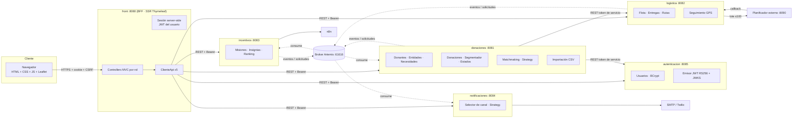
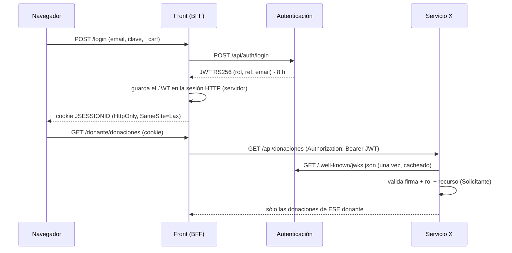

# Arquitectura de DonaTrack

## 1. ¿Qué estilo de arquitectura conviene? Análisis de alternativas

Antes de elegir, comparamos los estilos candidatos contra los **impulsores de arquitectura** del enunciado:

| Impulsor (del enunciado) | Peso |
|---|---|
| D1. Los servicios están definidos explícitamente (Donaciones, Logística, Incentivos, Notificaciones, Autenticación, Front SSR) | Alto |
| D2. Integración con Notificaciones **asincrónica por cola**, "para no afectar la disponibilidad ante picos o fallas" | Alto |
| D3. Persistencia **políglota**: Logística documental, el resto relacional, esquema propio por servicio | Alto |
| D4. Cliente liviano **desacoplado** que consume APIs REST (Entrega 5) | Alto |
| D5. Entrega 6: despliegue en la nube, observabilidad, rate limiting, *bonus* microservicios (registry + gateway) | Medio |
| D6. Equipo chico (estudiantes), recursos limitados, demo local | Alto |

| Estilo | A favor | En contra | Veredicto |
|---|---|---|---|
| **Monolito en capas** (una app, una base) | Simplísimo de desarrollar, probar y desplegar; transacciones ACID entre todo | Contradice D1, D3 (una sola base) y D4 (el front no sería un cliente desacoplado); el acoplamiento crece sin límites | ❌ No cumple el enunciado |
| **Monolito modular** (una app, módulos con límites estrictos) | Límites claros con costo operativo mínimo; refactor barato | Sigue siendo un único proceso: no hay cola real "entre servicios" (D2), ni persistencia políglota independiente (D3) | ⚠️ Excelente *punto de partida* en un proyecto real, pero no satisface D1–D3 |
| **Servicios por contexto acotado** (*service-based architecture*: pocos servicios de grano grueso, cada uno con su base) | Cumple D1–D4; cada servicio es un *bounded context* completo; número de procesos manejable (6 + broker) | Consistencia eventual entre servicios; más infraestructura que un monolito | ✅ **Elegido** |
| **Microservicios "puros"** (grano fino, un servicio por agregado, registry, gateway, malla) | Escalado y despliegue independiente máximo | Para este dominio sería sobre-ingeniería: decenas de procesos, transacciones distribuidas por todos lados; D6 lo desaconseja | ⚠️ Se deja como **evolución** (bonus Entrega 6) |
| **Serverless / FaaS** | Pago por uso, sin servidores | *Cold starts*, difícil de correr local, *vendor lock-in*; mal encaje con SSR con sesión y con el procesamiento batch de 20.000 filas | ❌ |

### Decisión

**Arquitectura basada en servicios por contexto acotado, cada uno con Arquitectura Hexagonal (puertos y adaptadores) por dentro**, integrados así:

* **Comandos** que necesitan respuesta inmediata → **REST sincrónico** (Front→servicios, Donaciones→Autenticación, Donaciones→Logística).
* **Hechos** (eventos de dominio, en pasado) → **mensajería asincrónica** por broker (Logística→Donaciones, Donaciones→Incentivos) y **todas** las notificaciones.

> **¿Por qué no una llamada REST de Logística a Donaciones cuando cambia una entrega?** Porque ya existe la llamada Donaciones→Logística (solicitar entrega). Si Logística también llamara a Donaciones tendríamos un **ciclo de dependencias sincrónicas**: si uno cae, el otro queda bloqueado. Con eventos, Logística *informa* y Donaciones *reacciona* cuando puede. El enunciado deja la direccionalidad "sujeta a discusión, priorizando bajo acoplamiento": esta es nuestra respuesta.

## 2. Vista de componentes



El diagrama de despliegue UML está en [`diagramas/despliegue.puml`](diagramas/despliegue.puml).

## 3. Arquitectura interna de cada servicio (Hexagonal + Screaming)

```
servicios/donaciones/src/main/java/ar/utn/donatrack/donaciones/
├── donantes/            ← el árbol "grita" el negocio, no el framework
│   ├── domain/          ← entidades, value objects, puertos de repositorio (Java puro)
│   ├── application/     ← casos de uso (1 clase = 1 caso de uso), puertos de salida
│   └── infrastructure/  ← JPA, REST controllers, adaptadores
├── beneficiarias/
├── donaciones/
├── asignacion/
├── importacion/
├── catalogo/
├── compartido/
└── configuracion/       ← composition root: único lugar donde se cablea todo
```

**Regla de dependencias** (verificable con `rg "springframework|jakarta.persistence" */domain`): `infrastructure → application → domain`, nunca al revés. El dominio no importa Spring, JPA, HTTP ni JMS. Los casos de uso son POJOs instanciados en la *composition root* (`ConfiguracionCasosDeUso`), por eso se prueban con fakes en memoria en milisegundos.

* **JPA**: entidades de persistencia separadas (`DonacionJpa`) con `desde()`/`aDominio()`. JPA exige anotaciones, constructor vacío y mutabilidad: separarlas protege los invariantes del dominio.
* **MongoDB (ODM)**: el dominio se persiste **tal cual**, sin anotaciones. Spring Data mapea por convención (campos + único constructor) y los índices se declaran en infraestructura (`IndicesMongo`). Distinta herramienta, distinta táctica, mismo principio.

## 4. Datos: cada servicio es dueño de los suyos

| Servicio | Almacén | Datos de otros servicios que guarda (desnormalizados) |
|---|---|---|
| Autenticación | Relacional | `referencia` (id del donante/entidad, patente) |
| Donaciones | Relacional | — (es la fuente de verdad de donantes, entidades y donaciones) |
| Logística | **Documental** | Nombre/dirección/coordenadas de la entidad, descripción de la donación, nombre del donante |
| Incentivos | Relacional | Contacto del donante y su actividad (proyección alimentada por eventos) |
| Notificaciones | Relacional | El destinatario de cada mensaje |

Nadie hace JOIN contra la base de otro. Las copias desnormalizadas se justifican por **lectura** (mapas, comprobantes, rankings) y se actualizan por eventos/comandos.

## 5. Mensajería

| Cola | Productor | Consumidor | Mensajes |
|---|---|---|---|
| `notificaciones.solicitudes` | Donaciones, Incentivos | Notificaciones | `SolicitudNotificacion` |
| `donaciones.eventos-logistica` | Logística | Donaciones | `EntregaPlanificada`, `RutaIniciada`, `EntregaRealizada`, `EntregaNoSatisfactoria`, `EntregaReprogramada` |
| `incentivos.eventos-donaciones` | Donaciones | Incentivos | `DonacionRegistrada`, `DonacionEntregada` |

* **Contratos** en el módulo `plataforma/contratos` (Java puro). El tipo viaja como identificador lógico (`_tipo=ruta.iniciada`), no como nombre de clase.
* **Entrega "al menos una vez"** + **consumidores idempotentes** (cada caso de uso verifica el estado antes de transicionar; Notificaciones usa el id del mensaje).
* **Transactional Outbox en Incentivos** (su propia tabla `outbox_mensajes`, en su base): los avisos de misión cumplida y de nueva categoría se registran en la misma transacción que otorga la insignia (`PublicadorColasConOutbox`) y `DespachadorOutbox` los publica cada 3 s, con el mismo formato y reintentos que en Donaciones. Se replicó el código en vez de compartirlo: cada servicio es dueño de su tabla, y una librería JPA común acoplaría a servicios que no usan JPA (Logística usa Mongo).
* **Transactional Outbox en Donaciones** (tabla `outbox_mensajes`), para todo lo que sale del servicio como efecto de un caso de uso:
  * **Comandos a Logística**: `solicitarEntrega` / `cancelarEntrega` no llaman por HTTP dentro de la transacción (`ServicioLogisticaConOutbox`).
  * **Mensajes JMS**: las `SolicitudNotificacion` y los eventos a Incentivos (`DonacionRegistrada`, `DonacionEntregada`) no se publican en el broker dentro de la transacción (`PublicadorColasConOutbox`); se guardan como `JMS:<tipo lógico>` con la cola como clave.

  Se guardan **en la misma transacción** que los cambios de la donación: si hay rollback, desaparecen con ella; si confirma, salen aunque el proceso caiga justo después del commit. `DespachadorOutbox` los entrega cada 3 s, en orden por clave (donación o cola), con hasta 20 reintentos ante caídas; un rechazo de negocio queda `FALLIDO` y se loguea. Garantía "al menos una vez", con destinos idempotentes: Logística por donación (índice único parcial `ux_entrega_activa_por_donacion`), Notificaciones por id de solicitud, Incentivos por id de donación.
* **Reintentos y DLQ**: 5 intentos con backoff exponencial y luego *Dead Letter Queue*.
* **Tolerancia a eventos perdidos**: `RutaIniciada` puede "ponerse al día" si no llegó `EntregaPlanificada`.

## 6. Seguridad



* **Autorización en dos niveles**: por rol en cada `SecurityFilterChain` y por **recurso** en los casos de uso (una entidad sólo confirma SUS entregas; un donante sólo ve SUS donaciones aunque pida otras).
* **Servicio↔servicio**: *client credentials* (`/api/auth/token-servicio`) con rol `SERVICIO`.
* **Callback del planificador**: secreto compartido en `X-Callback-Token` (comparación en tiempo constante).
* **Contraseñas**: BCrypt. **Tokens de activación**: 256 bits aleatorios, se guarda sólo su SHA-256, un solo uso, vencen a los 7 días.
* **Privacidad (Ley 25.326)**: las vistas públicas no exponen donantes; el seguimiento filtra las paradas que no le corresponden a quien mira. La difusión de logros en redes es **opt-in**: una casilla propia (desmarcada y separada de los términos) en el autorregistro de la persona humana. El consentimiento queda guardado en Donaciones, viaja en `DonacionRegistrada` y define el perfil nuevo en Incentivos; después el donante lo cambia desde su panel. Un alta hecha por terceros (administración, CSV) nunca lo otorga.

## 7. Camino de evolución (Entrega 6)

| Tema | Estado actual (local) | Próximo paso |
|---|---|---|
| Despliegue | **Local** (decisión del equipo): JARs + `scripts/iniciar.*` + vigilante | Imagen Docker por servicio + `docker compose` en una VM, o PaaS (Render/Railway/Fly.io). **Pendiente**: el req. 1 de la E6 pide acceso público |
| Base relacional | H2 en archivo, modo PostgreSQL | Perfil `postgres` ya configurado (`SPRING_PROFILES_ACTIVE=postgres`); migraciones con Flyway |
| MongoDB | Embebido (flapdoodle) | Perfil `mongo` con `MONGO_URI` (Atlas) |
| Broker | Artemis embebido en proceso propio | Artemis/RabbitMQ gestionado (sólo cambia `spring.artemis.broker-url`) |
| Observabilidad | **Implementado**: métricas Prometheus, trazas OTel→Tempo (W3C entre servicios), logs JSON ECS→Loki, Grafana con alertas (`docs/observabilidad.md`) | Alertmanager con notificación (mail/Slack) |
| Rate limiting | **Implementado** en el BFF (front): Bucket4j por IP, 3 políticas, 429 + `Retry-After` | Bucket distribuido (Redis) o en el API Gateway si hay varias instancias |
| gRPC / GraphQL | **Implementado**: GraphQL en Logística (`/graphql`, rol ADMIN): filtros combinables + selección de campos + paginación | Consumirlo desde el dashboard de monitoreo del front |
| Microservicios (bonus) | Servicios independientes ya desplegables por separado | Spring Cloud Gateway + Eureka/Consul; el front pasaría a hablar sólo con el gateway |
| Outbox (bonus) | **Implementado** en Donaciones (comandos a Logística, notificaciones, eventos a Incentivos) y en Incentivos (avisos de misión cumplida y categoría) | Llevarlo a los eventos de Logística (Mongo: requiere réplica para transacciones) y despachar con `SELECT ... FOR UPDATE SKIP LOCKED` para varias instancias |
