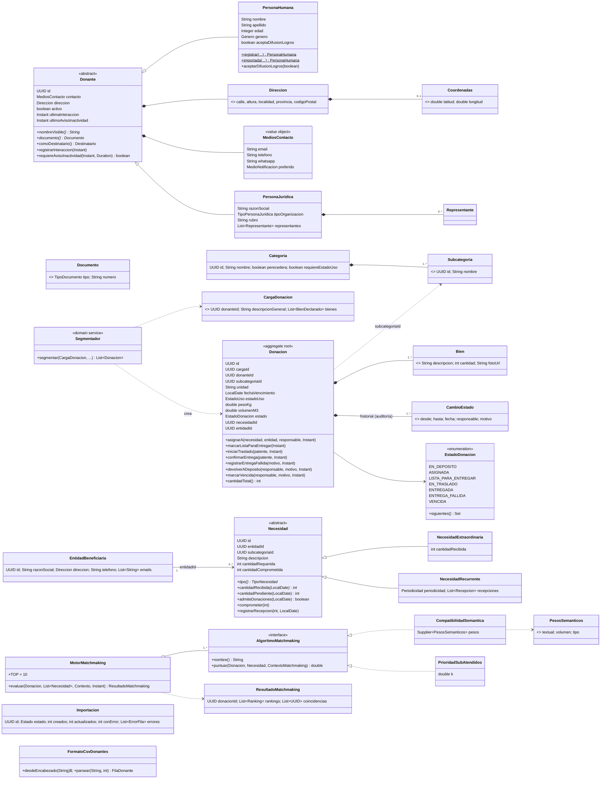
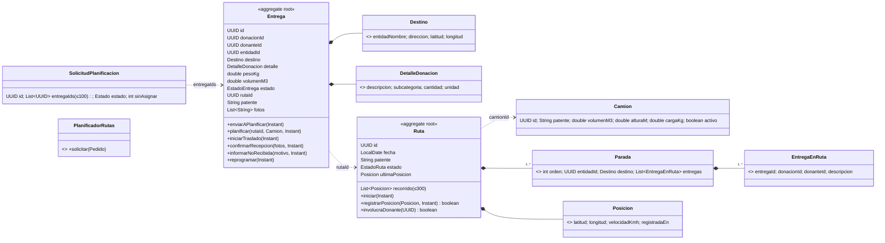
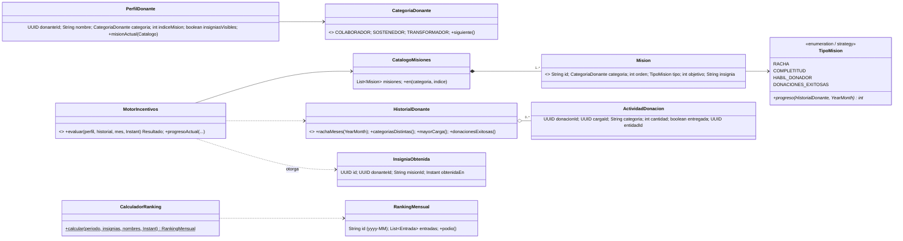
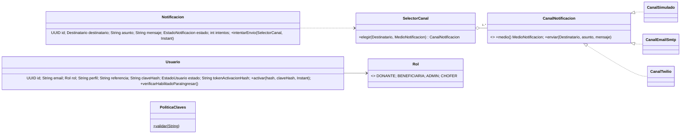
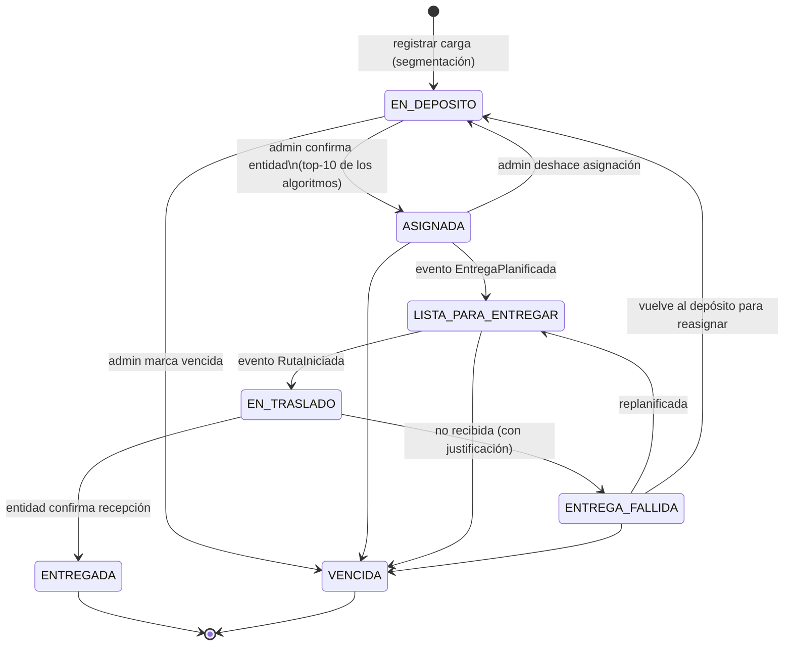
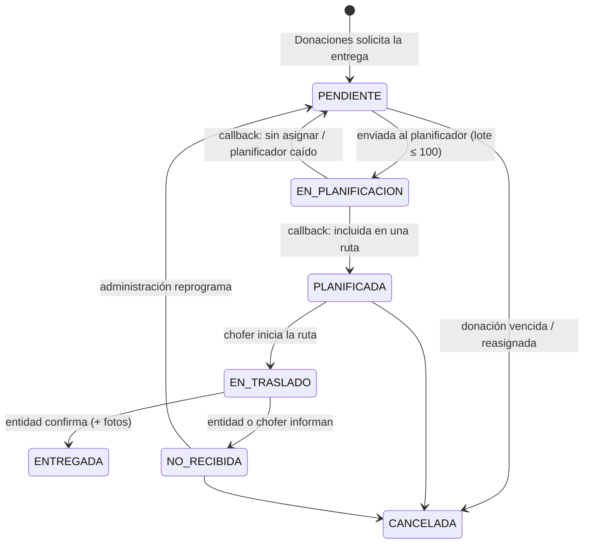
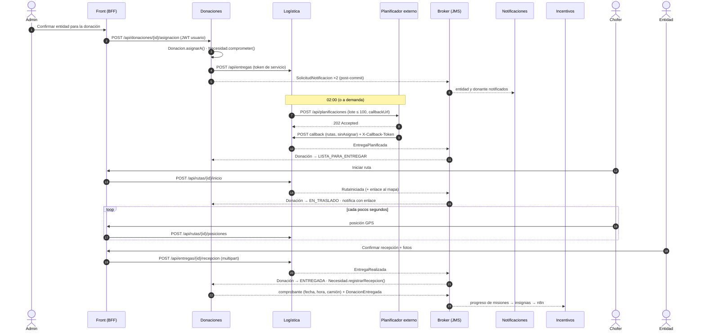

# Modelo de dominio y modelos de datos

> Diagramas en Mermaid: se renderizan en GitHub/GitLab, VS Code (extensión *Markdown Preview Mermaid*) o en <https://mermaid.live>.
> Los diagramas UML de **casos de uso** y **despliegue** están en PlantUML: [`diagramas/casos-de-uso.puml`](diagramas/casos-de-uso.puml) y [`diagramas/despliegue.puml`](diagramas/despliegue.puml).

---

## 1. Servicio de Donaciones



## 2. Servicio de Logística (persistencia documental)



## 3. Servicio de Incentivos



## 4. Servicios de Notificaciones y Autenticación



---

## 5. Estados de una donación (trazabilidad)



## 6. Estados de una entrega (Logística)



## 7. Secuencia del flujo principal (asignación → entrega)



---

## 8. Modelo de datos relacional (DER físico por servicio)

Cada servicio tiene **su propio esquema** (en local: un archivo H2 por servicio; en producción: un esquema PostgreSQL por servicio sobre el mismo motor, perfil `postgres`). No hay claves foráneas **entre** servicios: las referencias cruzadas son UUID (consistencia eventual vía eventos).

### 8.1 Donaciones

```mermaid
erDiagram
    DONANTES ||--o{ DONANTES_REPRESENTANTES : tiene
    DONANTES {
        uuid id PK
        varchar tipo "HUMANA | JURIDICA (discriminador)"
        varchar email UK
        varchar telefono
        varchar whatsapp
        varchar medio_preferido
        varchar nombre_visible "desnormalizado: búsqueda/orden"
        varchar tipo_documento
        varchar numero_documento
        varchar nombre "sólo HUMANA"
        varchar apellido "sólo HUMANA"
        int edad "sólo HUMANA"
        varchar genero "sólo HUMANA"
        boolean acepta_difusion_logros "sólo HUMANA; opt-in, NULL = no"
        varchar razon_social "sólo JURIDICA"
        varchar tipo_organizacion "sólo JURIDICA"
        varchar rubro "sólo JURIDICA"
        varchar calle
        varchar localidad
        double latitud
        double longitud
        boolean activo
        timestamp ultima_interaccion "índice compuesto con activo"
        timestamp ultimo_aviso_inactividad
    }
    DONANTES_REPRESENTANTES { uuid donante_id FK; varchar nombre; varchar email }

    CATEGORIAS ||--|{ SUBCATEGORIAS : contiene
    CATEGORIAS { uuid id PK; varchar nombre; boolean perecedera; boolean requiere_estado_uso }
    SUBCATEGORIAS { uuid categoria_id FK; uuid subcategoria_id; varchar nombre }

    DONACIONES ||--|{ DONACIONES_BIENES : contiene
    DONACIONES ||--|{ DONACIONES_HISTORIAL : audita
    DONACIONES {
        uuid id PK
        uuid carga_id "agrupa la carga única"
        uuid donante_id "ref. lógica"
        uuid subcategoria_id
        varchar subcategoria_nombre "desnormalizado"
        varchar categoria_nombre "desnormalizado: filtro sin JOIN"
        int cantidad_total "desnormalizado"
        varchar unidad
        date fecha_vencimiento
        varchar estado_uso
        double peso_kg
        double volumen_m3
        varchar estado "índice"
        uuid necesidad_id
        uuid entidad_id "índice (entidad, estado)"
        varchar patente_entrega
        timestamp entregada_en "índice (estado, entregada_en)"
        timestamp registrada_en
    }
    DONACIONES_BIENES { uuid donacion_id FK; int orden; varchar descripcion; int cantidad; varchar foto_url }
    DONACIONES_HISTORIAL { uuid donacion_id FK; int orden; varchar desde; varchar hasta; timestamp fecha; varchar responsable; varchar motivo }

    ENTIDADES_BENEFICIARIAS ||--|{ ENTIDADES_EMAILS : tiene
    ENTIDADES_BENEFICIARIAS { uuid id PK; varchar razon_social; varchar email_principal UK; varchar telefono; varchar calle; double latitud; double longitud; boolean activa }
    ENTIDADES_EMAILS { uuid entidad_id FK; int orden; varchar email }

    NECESIDADES ||--o{ NECESIDADES_RECEPCIONES : registra
    NECESIDADES {
        uuid id PK
        varchar tipo "EXTRAORDINARIA | RECURRENTE"
        uuid entidad_id "índice"
        uuid subcategoria_id "índice (subcategoria, activa)"
        varchar descripcion
        int cantidad_requerida
        int cantidad_comprometida
        int cantidad_recibida "sólo EXTRAORDINARIA"
        varchar periodicidad "sólo RECURRENTE"
        boolean activa
    }
    NECESIDADES_RECEPCIONES { uuid necesidad_id FK; date fecha; int cantidad }

    RESULTADOS_MATCHMAKING ||--o{ RESULTADOS_PUNTAJES : contiene
    RESULTADOS_MATCHMAKING ||--o{ RESULTADOS_COINCIDENCIAS : contiene
    RESULTADOS_MATCHMAKING { uuid donacion_id PK; timestamp ejecutado_en }
    RESULTADOS_PUNTAJES { uuid donacion_id FK; int orden; varchar algoritmo; int posicion; uuid necesidad_id; double valor }
    RESULTADOS_COINCIDENCIAS { uuid donacion_id FK; int orden; uuid necesidad_id }
    CONFIGURACION_MATCHMAKING { varchar clave PK; double peso_textual; double peso_volumen; double peso_tipo }

    IMPORTACIONES ||--o{ IMPORTACIONES_ERRORES : reporta
    IMPORTACIONES { uuid id PK; varchar archivo; varchar estado; int filas_procesadas; int creados; int actualizados; int con_error }
    IMPORTACIONES_ERRORES { uuid importacion_id FK; int linea; varchar mensaje }
```

### 8.2 Incentivos, Notificaciones y Autenticación

```mermaid
erDiagram
    PERFILES_DONANTES { uuid donante_id PK; varchar nombre; varchar email; varchar categoria; int indice_mision; boolean insignias_visibles }
    ACTIVIDAD_DONACIONES { uuid donacion_id PK; uuid donante_id "índice (donante, fecha)"; uuid carga_id; varchar categoria; int cantidad; timestamp registrada_en; boolean entregada; uuid entidad_id }
    INSIGNIAS { uuid id PK; uuid donante_id "índice"; varchar mision_id; varchar nombre; timestamp obtenida_en "índice" }
    RANKINGS_MENSUALES ||--|{ RANKINGS_ENTRADAS : contiene
    RANKINGS_MENSUALES { varchar id PK "yyyy-MM"; int anio; int mes; timestamp generado_en }
    RANKINGS_ENTRADAS { varchar ranking_id FK; int orden; int posicion; uuid donante_id; varchar nombre "desnormalizado"; int misiones_cumplidas }

    NOTIFICACIONES { uuid id PK "idempotencia"; varchar destinatario_email "índice (email, fecha)"; varchar medio_utilizado; varchar asunto; varchar mensaje; varchar estado "índice"; int intentos; boolean leida }

    USUARIOS { uuid id PK; varchar email UK; varchar rol; varchar perfil; varchar referencia; varchar clave_hash "BCrypt"; varchar estado; varchar token_activacion_hash "SHA-256, índice" }
```

## 9. Modelo documental (Logística · MongoDB)

```text
camiones                     { _id: UUID, patente (único), volumenM3, alturaM, cargaKg, activo }

entregas                     { _id, donacionId (índice), donanteId, donanteNombre, entidadId (índice),
                               destino: { entidadNombre, direccion, latitud, longitud },     ← embebido / desnormalizado
                               detalle: { descripcion, subcategoria, cantidad, unidad },     ← embebido / desnormalizado
                               pesoKg, volumenM3, estado (índice con creadaEn), rutaId (índice),
                               camionId, patente, fotos: [url], motivoNoRecepcion, entregadaEn,
                               historial: [ { estado, fecha, detalle } ] }

rutas                        { _id, fecha, camionId, patente, estado,
                               paradas: [ { orden, entidadId, destino: {...},
                                            entregas: [ { entregaId, donacionId, donanteId, descripcion } ] } ],
                               ultimaPosicion: { latitud, longitud, velocidadKmh, registradaEn },
                               recorrido: [ ...máx. 300 posiciones ($push + $slice) ] }
                             índices: (estado, paradas.entregas.donanteId), (estado, paradas.entidadId), (patente, estado)

solicitudes_planificacion    { _id, fechaRutas, entregaIds: [≤ 100], estado, enviadaEn, completadaEn, rutasGeneradas, sinAsignar }
```
