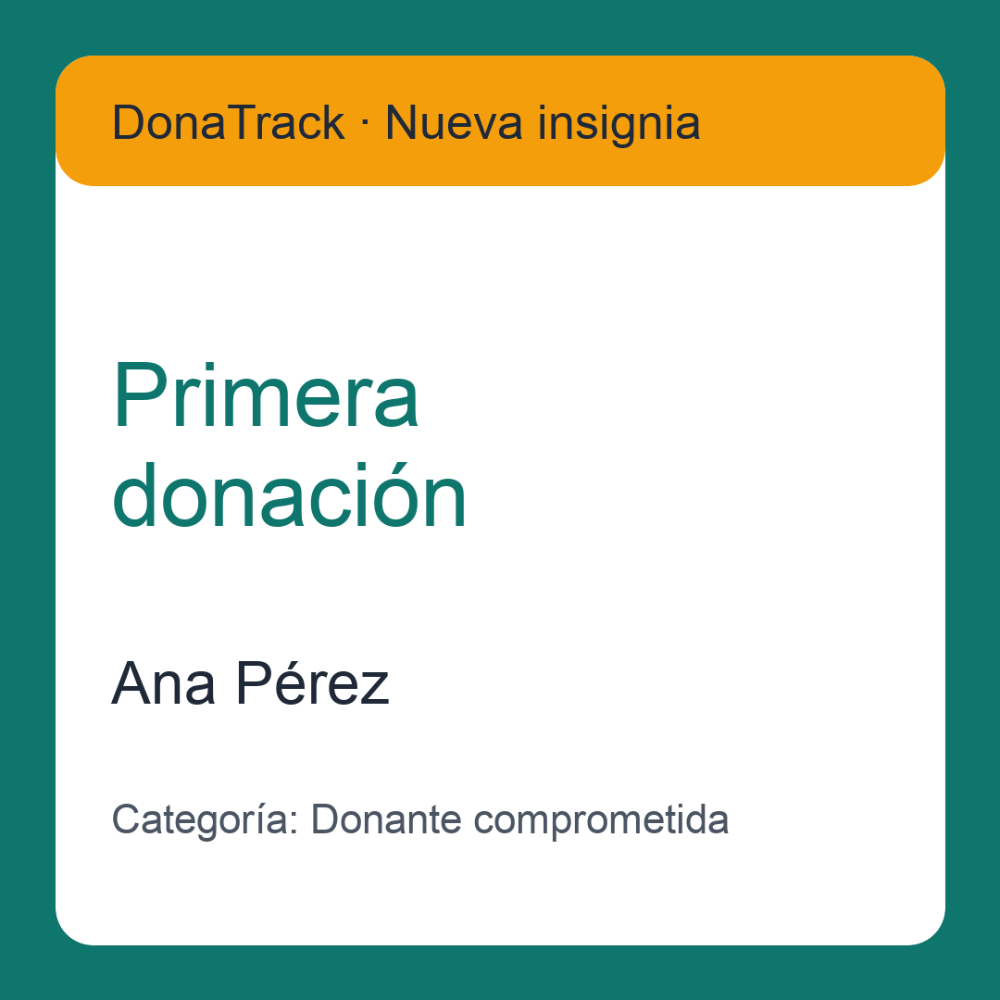

# Difusión de insignias con n8n (low-code)

**Qué pide el enunciado:** cuando un donante obtiene una insignia, un flujo recibe un texto descriptivo,
**genera una imagen** de la insignia y la **publica mencionando al usuario**.

**Decisión del equipo:** todo local, sin publicar en redes reales. El flujo hace el proceso completo y la
"publicación" se guarda en disco (imagen + post). Para una red real se reemplazan SÓLO los dos nodos
`Publicar (local): ...` por el nodo de la red elegida (X, LinkedIn, Mastodon, Telegram): el resto no cambia.

## El flujo (`difusion-insignias.json`)

```
Incentivos ──POST──▶ Webhook ─▶ Armar publicación ─▶ Generar imagen ─▶ Guardar imagen ─▶ Registro ─▶ JSON ─▶ Guardar post
                                (texto + @mención)    (Edit Image:      (/home/node/
                                                       lienzo, franja,   publicaciones)
                                                       textos)
```

| Nodo | Hace |
|---|---|
| Webhook: insignia obtenida | Recibe de Incentivos `{donanteId, nombre, categoria, insignia, icono, texto, obtenidaEn}`. Responde al instante (`onReceived`): la difusión no demora al servicio |
| Armar publicación | Texto final con emoji, mención `@NombreApellido` y hashtags |
| Generar imagen de la insignia | **Genera** una tarjeta PNG 1080×1080 con GraphicsMagick (multi-step: crear lienzo, dibujar, escribir textos). Sin servicios externos |
| Publicar (local) | Guarda `<donanteId>-<fecha>.png` y `<donanteId>-<fecha>.json` (texto, mención, imagen, fecha) |

Validado con el validador de n8n (7 nodos, 6 conexiones, 22 expresiones, 0 errores) y **ejecutado**
en n8n 1.72.1 local el 24/11/2026. Resultado real: [`ejemplo-tarjeta-insignia.png`](ejemplo-tarjeta-insignia.png)
y [`ejemplo-post-insignia.json`](ejemplo-post-insignia.json).



## Demo local (requiere Docker)

1. Levantar n8n: `docker compose -f infraestructura-local/n8n/docker-compose.yml up -d` → <http://localhost:5678> (crear el usuario owner la primera vez).
2. Importar: menú **Workflows → Import from File** → `docs/n8n/difusion-insignias.json`, o por consola:
   ```bash
   export MSYS_NO_PATHCONV=1   # sólo Git Bash: si no, convierte /flujos en C:/Program Files/Git/flujos
   docker compose -f infraestructura-local/n8n/docker-compose.yml exec -T n8n n8n import:workflow --separate --input=/flujos
   ```
   (`--separate` porque el archivo es UN flujo, como lo exporta la UI; sin él la CLI espera un arreglo.)
3. **Activar** el flujo (switch *Active*): sólo así responde la URL de producción. Por consola:
   `n8n list:workflow` para ver el id, `n8n update:workflow --id=<id> --active=true` y
   `docker compose -f infraestructura-local/n8n/docker-compose.yml restart` (la CLI sólo surte efecto al reiniciar).
4. Arrancar DonaTrack con el webhook configurado:
   * PowerShell: `$env:N8N_WEBHOOK_URL = "http://localhost:5678/webhook/donatrack-insignia"; .\scripts\iniciar.ps1`
   * Bash: `N8N_WEBHOOK_URL=http://localhost:5678/webhook/donatrack-insignia ./scripts/iniciar.sh`
5. Hacer que un donante complete una misión (p. ej. registrar su primera donación) → en
   `data/n8n/publicaciones/` aparecen la tarjeta PNG y el post JSON. La ejecución también se ve en n8n (*Executions*).

Prueba directa sin DonaTrack. El cuerpo va en un **archivo UTF-8**: en Windows, un JSON pasado como
argumento de `curl` se convierte a la página de códigos ANSI y la tarjeta sale con "donaci□n" y "P□rez"
(no es un error del flujo; Incentivos manda UTF-8).

```bash
# insignia.json (guardado en UTF-8):
# {"donanteId":"demo","nombre":"Ana Pérez","categoria":"Donante comprometida","insignia":"Primera donación","icono":"🎉","texto":"Ana Pérez obtuvo la insignia Primera donación"}
curl -X POST http://localhost:5678/webhook/donatrack-insignia -H "Content-Type: application/json; charset=utf-8" \
  --data-binary @insignia.json
```

La respuesta (`Workflow was started`) llega antes de que termine el flujo: los archivos aparecen uno o
dos segundos después.

Si `N8N_WEBHOOK_URL` no está configurada, Incentivos sólo registra la difusión en el log (la insignia se otorga igual).
